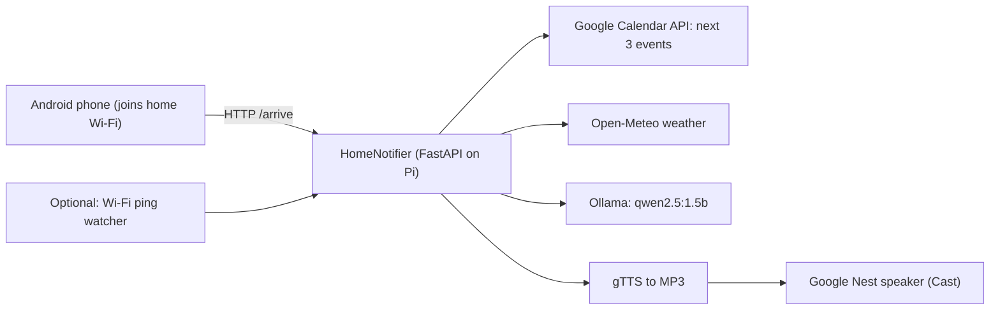

# HomeNotifier

A small server for a Raspberry Pi 5 that notices when you get home and has your
Google Nest / Home speaker give you a short spoken briefing:

> "Welcome home Gilbert! It's 21 degrees and partly cloudy, with a 10% chance of
> rain. Next up you've got Dentist tomorrow at 9:30 AM, then Team standup at
> 10 AM, and Mum's birthday dinner on Saturday at 6 PM."



- **Calendar:** Google Calendar API (read-only).
- **Weather:** [Open-Meteo](https://open-meteo.com/). Free, no API key.
- **Wording:** a small Qwen model running locally in Ollama. If Ollama is down
  you still get a plain template message.
- **Voice:** Google TTS (gTTS) renders an MP3. The Pi serves it, and the speaker
  plays it over Google Cast. No Google Assistant SDK is needed.
- **Triggers:** your phone calls `/arrive` when it connects to the home Wi-Fi.
  There's also an optional built-in watcher that pings your phone, so you
  don't need an app at all.

---

## Contents

1. [Which Android phones can trigger this?](#1-which-android-phones-can-trigger-this)
2. [Install on the Pi](#2-install-on-the-pi)
3. [Install Ollama and a Qwen model](#3-install-ollama-and-a-qwen-model)
4. [Set up Google Calendar API access](#4-set-up-google-calendar-api-access)
5. [Configure](#5-configure)
6. [Test it](#6-test-it)
7. [Run as a systemd service](#7-run-as-a-systemd-service)
8. [Set up the phone trigger](#8-set-up-the-phone-trigger)
9. [API reference](#9-api-reference)
10. [Troubleshooting](#10-troubleshooting)

---

## 1. Which Android phones can trigger this?

**"Modes and Routines" is Samsung-only.** It's part of Samsung's One UI.
Pixel, Motorola, OnePlus, Xiaomi and other brands don't have it. Some have
their own versions (Pixel has "Modes", Motorola has "Moto Actions"), but those
can't call a web URL anyway.

So this project doesn't rely on anything brand-specific. Pick one of these:

| Option | Works on | Cost | Notes |
|---|---|---|---|
| **MacroDroid** | Any Android 6+ | Free (up to 5 macros) | Easiest. "Wi-Fi SSID connected" trigger → "HTTP Request" action. |
| **Tasker** | Any Android | One-off ~AU\$6 | The most powerful option. "Wi-Fi Connected" profile → "HTTP Request" task. |
| **Automate** (LlamaLab) | Any Android | Free (up to 30 blocks) | Flowchart-style. |
| **HTTP Shortcuts** | Any Android | Free, open source | Manual button or home-screen widget. Good for testing. |
| **Built-in Wi-Fi presence** | Any phone, **including iPhone** | Free | No app needed. The Pi pings your phone. See [§8.4](#84-option-d-no-app-at-all-wi-fi-presence-detection). |

All of these are available on any Android brand. If you change phones, you
only need to set the trigger up again. The server stays the same.

> [!TIP]
> Trigger on **"connected to home Wi-Fi"** rather than a GPS geofence. It's
> more reliable, it uses less battery, and the request stays on your LAN, so
> the Pi never has to be exposed to the internet.

---

## 2. Install on the Pi

These steps were tested on Raspberry Pi OS Bookworm (64-bit). The examples
assume the user is `pi`. If yours is different, swap in your username in the
paths below and in the service file.

```bash
sudo apt update
sudo apt install -y git python3-venv python3-pip

cd ~
git clone <your-repo-url> HomeNotifier
cd HomeNotifier

python3 -m venv .venv
.venv/bin/pip install --upgrade pip
.venv/bin/pip install -r requirements.txt

cp .env.example .env
chmod 600 .env
mkdir -p secrets audio_cache
```

**Give the Pi and the speaker fixed IPs.** Set a DHCP reservation for each
one on your router. The speaker downloads the MP3 from the Pi, so the Pi's
address needs to stay the same.

---

## 3. Install Ollama and a Qwen model

```bash
curl -fsSL https://ollama.com/install.sh | sh     # installs + enables ollama.service
ollama pull qwen2.5:1.5b
ollama run qwen2.5:1.5b "Say hello in one sentence."
```

Model choices for an 8 GB Pi 5 that's also running other services:

| Model | RAM while loaded | Speed on Pi 5 | Notes |
|---|---|---|---|
| `qwen2.5:0.5b` | ~0.5 GB | very fast | Sometimes clumsy wording |
| **`qwen2.5:1.5b`** (default) | ~1.2 GB | ~5–10 s per message | Good balance |
| `qwen3:1.7b` | ~1.5 GB | ~8–15 s | Set `OLLAMA_THINK=false` |
| `qwen2.5:3b` | ~2.3 GB | ~15–25 s | Nicer wording, slower |

Memory tips:
- `OLLAMA_KEEP_ALIVE=0` in `.env` unloads the model right after each message.
  The next message takes a few extra seconds to start, but the RAM is free the
  rest of the time.
- Ollama only listens on `127.0.0.1:11434` by default. Leave it that way.

---

## 4. Set up Google Calendar API access

### 4.1 Create a project and enable the API (needed for both options)

1. Go to <https://console.cloud.google.com/> and create a project, e.g.
   `HomeNotifier`.
2. Open **APIs & Services → Library**, search for **Google Calendar API**, and
   click **Enable**.

Then choose **one** of the two options below.

### 4.2 Option A: Service account (recommended for a headless Pi)

There's no browser login, and the credentials never expire.

1. Open **IAM & Admin → Service Accounts → Create service account**. Give it a
   name like `homenotifier`. It doesn't need any roles.
2. Open the service account, go to **Keys → Add key → Create new key → JSON**,
   and download the file.
3. Copy the key to the Pi:
   ```bash
   scp homenotifier-xxxx.json pi@<pi-ip>:~/HomeNotifier/secrets/service_account.json
   ssh pi@<pi-ip> chmod 600 ~/HomeNotifier/secrets/service_account.json
   ```
4. Share your calendar with the service account:
   - Open [Google Calendar](https://calendar.google.com) → ⚙ **Settings** →
     your calendar under *Settings for my calendars* → **Share with specific
     people or groups** → **Add people**.
   - Paste the service account's email
     (`homenotifier@<project>.iam.gserviceaccount.com`).
   - Choose **See all event details**.
5. In `.env`:
   ```ini
   GOOGLE_SERVICE_ACCOUNT_FILE=/home/pi/HomeNotifier/secrets/service_account.json
   GOOGLE_CALENDAR_ID=you@gmail.com
   ```
   Use your own email address here, **not** `primary`. With a service account,
   `primary` would be the service account's own (empty) calendar.

> [!NOTE]
> Google Workspace (work or school) accounts may block sharing with external
> addresses. If yours does, use Option B.

### 4.3 Option B: OAuth desktop client

1. **APIs & Services → OAuth consent screen**:
   - User type: **External**. Fill in the app name and your email.
   - Add the scope `.../auth/calendar.readonly`.
   - Under **Audience / Test users**, add your own Google account.
2. **APIs & Services → Credentials → Create credentials → OAuth client ID →
   Desktop app**. Download the JSON and save it as
   `secrets/client_secret.json`.
3. Authorise once. The easiest way is on your laptop:
   ```bash
   python3 -m venv .venv && .venv/bin/pip install -r requirements.txt
   .venv/bin/python scripts/authorize_google.py
   scp secrets/token.json pi@<pi-ip>:~/HomeNotifier/secrets/
   ```
   Or do it on the Pi over an SSH tunnel:
   ```bash
   ssh -L 8085:localhost:8085 pi@<pi-ip>
   cd ~/HomeNotifier && .venv/bin/python scripts/authorize_google.py --no-browser
   # open the printed URL in your laptop's browser
   ```

> [!WARNING]
> **While the consent screen is in "Testing", the refresh token expires after
> 7 days.** To avoid this, open the OAuth consent screen and click **Publish
> app → In production**. You don't need Google's verification for personal
> use. When you log in, you'll see a *"Google hasn't verified this app"*
> screen. Click **Advanced → Go to HomeNotifier**. After that the token keeps
> working indefinitely.

---

## 5. Configure

Edit `~/HomeNotifier/.env`. Every setting is described in
[.env.example](.env.example). The main ones:

```ini
HN_AUTH_TOKEN=<output of: openssl rand -hex 24>
HN_OWNER_NAME=Gilbert
HN_TIMEZONE=Australia/Sydney
WEATHER_LATITUDE=-33.87
WEATHER_LONGITUDE=151.21
SPEAKER_NAME=Kitchen speaker
```

To find your speaker's exact name and IP:

```bash
.venv/bin/python scripts/list_speakers.py
# 'Kitchen speaker'                   Google Nest Mini          192.168.1.40
```

Set `SPEAKER_NAME` to the name in quotes, and `SPEAKER_IP` to the IP address.
Setting the IP makes discovery more reliable.

Speaker groups also work. Use the group name, e.g. `Downstairs`.

---

## 6. Test it

```bash
cd ~/HomeNotifier
.venv/bin/python -m homenotifier
```

In another terminal:

```bash
TOKEN=$(grep ^HN_AUTH_TOKEN .env | cut -d= -f2)

curl localhost:8765/health
curl -H "Authorization: Bearer $TOKEN" localhost:8765/preview          # text only, no audio
curl -X POST -H "Authorization: Bearer $TOKEN" -H 'Content-Type: application/json' \
     -d '{"text":"Hello from the Pi"}' localhost:8765/say                # speaker test
curl -X POST -H "Authorization: Bearer $TOKEN" "localhost:8765/arrive?force=true&delay=0"
```

Interactive API docs are at `http://<pi-ip>:8765/docs`.

---

## 7. Run as a systemd service

The unit file is [systemd/homenotifier.service](systemd/homenotifier.service).
If your username isn't `pi`, edit `User`, `Group` and the `/home/pi/...`
paths first.

```bash
sudo cp systemd/homenotifier.service /etc/systemd/system/
sudo systemctl daemon-reload
sudo systemctl enable --now homenotifier
systemctl status homenotifier
journalctl -u homenotifier -f          # live logs
```

The unit:
- starts after the network and `ollama.service`
- restarts on failure
- is capped at 512 MB RAM and runs at a lower CPU priority, so it plays nicely
  with your other services
- uses a read-only filesystem, apart from `audio_cache/` and `secrets/`.
  Both directories must exist before the service starts.

After editing `.env`, run `sudo systemctl restart homenotifier`.

---

## 8. Set up the phone trigger

The phone needs to call:

```
POST http://<pi-ip>:8765/arrive
Header: Authorization: Bearer <HN_AUTH_TOKEN>
```

If an app makes it awkward to add headers, you can use
`http://<pi-ip>:8765/arrive?token=<HN_AUTH_TOKEN>` instead (GET or POST).

The server already handles the edge cases for you:
- **Cooldown:** repeat calls within `HN_COOLDOWN_MINUTES` are ignored, so Wi-Fi
  flapping is harmless.
- **Delay:** it waits `HN_ARRIVAL_DELAY_SECONDS` before speaking, which gives
  you time to get inside.
- **Quiet hours:** nothing is announced during `HN_QUIET_HOURS`.

### 8.1 Option A: MacroDroid (free, easiest)

1. **Add Macro**.
2. **Trigger:** *Connectivity → Wi-Fi SSID Transition → Connected to network*.
   Select your home SSID.
3. **Action:** *Connectivity → HTTP Request*.
   - Method: `POST`
   - URL: `http://<pi-ip>:8765/arrive`
   - Headers: `Authorization` = `Bearer <token>`
4. When prompted, grant **Location** permission ("Allow all the time"). Since
   Android 10, apps need it to read the Wi-Fi name. Also turn off battery
   optimisation for MacroDroid.

### 8.2 Option B: Tasker

1. **Profiles → + → State → Net → Wifi Connected** and set the SSID to your
   home network.
2. New task → **+ → Net → HTTP Request**:
   - Method `POST`, URL `http://<pi-ip>:8765/arrive`
   - Headers `Authorization:Bearer <token>`
3. Grant location permission and turn off battery optimisation for Tasker.

### 8.3 Option C: Automate / HTTP Shortcuts

- **Automate:** add a *Wi-Fi network connected?* block (SSID = home), then an
  *HTTP request* block.
- **HTTP Shortcuts:** create a POST shortcut with the header. You can tap it
  manually, or let Tasker or MacroDroid run it.

### 8.4 Option D: No app at all (Wi-Fi presence detection)

The Pi pings your phone's IP every 30 s. If the phone hasn't answered for
`PRESENCE_AWAY_MINUTES`, it's marked away. The next time it answers, that
counts as an arrival.

1. Give your phone a **DHCP reservation** on the router.
2. On the phone: **Settings → Wi-Fi → your network → Privacy → Use device
   MAC**. The default randomised MAC also works, because it stays the same
   for each network.
3. In `.env`:
   ```ini
   PRESENCE_PHONE_IP=192.168.1.60
   PRESENCE_AWAY_MINUTES=20
   ```

> [!NOTE]
> Sleeping phones sometimes ignore pings. A long `PRESENCE_AWAY_MINUTES`
> (15–30 min) plus the cooldown avoids false "welcome home" messages, but
> this method is less precise than an app trigger. You can run both together
> safely: the cooldown stops you hearing the briefing twice.

---

## 9. API reference

| Method | Path | Auth | Description |
|---|---|---|---|
| GET | `/health` | no | Liveness check |
| GET/POST | `/arrive?force=&delay=` | yes | Trigger the arrival briefing (returns 202 immediately) |
| GET | `/preview` | yes | Build the briefing text without speaking it |
| POST | `/say` `{"text": "..."}` | yes | Speak any text |
| GET/HEAD | `/audio/{file}.mp3` | no | Used by the speaker to fetch audio |

Auth can be sent as `Authorization: Bearer <token>`, `X-Auth-Token: <token>`,
or `?token=<token>`.

---

## 10. Troubleshooting

| Symptom | Fix |
|---|---|
| `Speaker not found` | Run `scripts/list_speakers.py`. The Pi and the speaker must be on the same subnet/VLAN, because Cast discovery uses mDNS. Set `SPEAKER_IP`. |
| Speaker chimes but stays silent | The speaker can't reach the Pi. Check `HN_PUBLIC_BASE_URL` (or the IP it auto-detected in the logs) and the firewall: `sudo ufw allow 8765/tcp`. |
| `Calendar unavailable` in logs | Service account: make sure the calendar is shared with it and `GOOGLE_CALENDAR_ID` is your email address. OAuth: run `authorize_google.py` again and publish the app (see the 7-day warning). |
| `invalid_grant` after a week | The OAuth app is still in "Testing". Publish it, then authorise again. |
| Message is the plain template | Ollama isn't reachable or timed out. Check `systemctl status ollama` and `ollama ps`, or raise `OLLAMA_TIMEOUT_SECONDS`. |
| Model invents events | Use a bigger model (`qwen2.5:3b`), or lower the temperature in [llm.py](homenotifier/llm.py). |
| Phone trigger never fires | Grant the automation app "Allow all the time" location access and turn off battery optimisation for it. |
| Wrong times | Set `HN_TIMEZONE`, or fix the Pi's timezone: `sudo timedatectl set-timezone Australia/Sydney`. |
